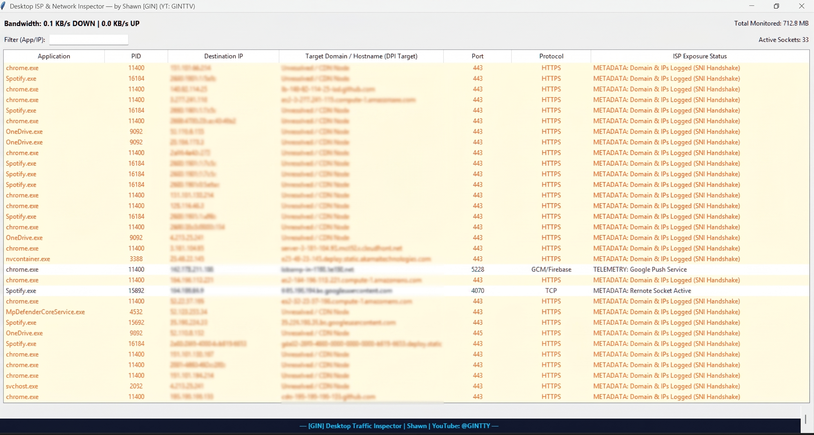
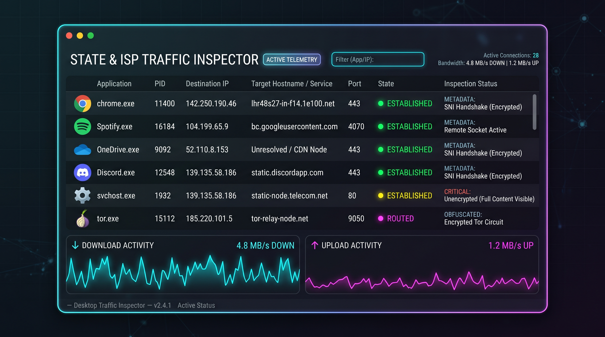

# Desktop ISP & Network Inspector


A real-time desktop diagnostic tool built with Python and Tkinter to monitor outbound network connections and visualize what metadata your Internet Service Provider (ISP) and network gateways log.




## Overview

Modern web traffic relies heavily on HTTPS (Port 443), which encrypts the payload but leaves critical metadata exposed across the wire:
- **Server Name Indication (SNI):** Cleartext domain handshakes.
- **DNS Queries:** Unencrypted port 53 lookups.
- **Connection Timing & Volume:** Distinct traffic fingerprinting.

This tool runs locally on your operating system, inspecting active outbound sockets to expose what remote hosts your applications are reaching out to in real time.

## Key Features

- **Process Attribution:** Automatically links remote connections to active applications (`chrome.exe`, `discord.exe`, etc.) and PIDs.
- **Asynchronous Reverse DNS:** Resolves raw destination IPs into human-readable hostnames and CDNs using non-blocking background threads.
- **Color-Coded Exposure Classification:**
  - 🔴 **Critical:** Unencrypted HTTP (Port 80) and DNS (Port 53) queries.
  - 🟡 **Metadata Logged:** Standard HTTPS (Port 443) with visible destination IPs and SNI headers.
  - 🟢 **Obfuscated / Tunnel:** Confirms traffic routing through local Tor proxies (Ports 9050/9150).
- **Live Bandwidth Metrics:** Tracks real-time upload/download speeds (KB/s) and session transfer totals.
- **Live Filter:** Search active connections by application name, IP, or domain.

## Installation & Setup

1. **Clone the repository:**
   ```bash
   git clone [https://github.com/shxwn9/desktop-isp-inspector.git](https://github.com/shxwn9/desktop-isp-inspector.git)
   cd desktop-isp-inspector
